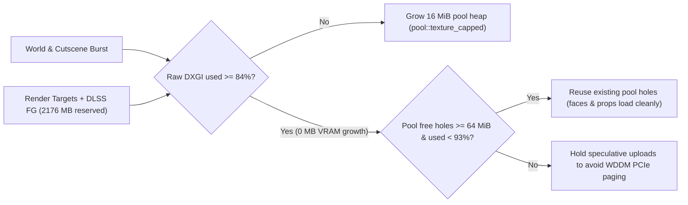

<div align="center">

# zhenek

**`VIctory` fork built specifically for budget 60/70-series 8 GB NVIDIA GPUs (RTX 3060 / 3060 Ti / 3070 / 4060 / 4060 Ti / 4070 / 5060)**  
*Branch: `rtx5060-8gb-clean` · Anti-paging 8 GB VRAM pool + Native DLSS Super Resolution & DLSS Frame Generation (2x–6x)*

[](https://github.com/d1reevo/zhenek/tree/rtx5060-8gb-clean)
[](#why-this-fork-exists-for-8-gb-gpus)
[](#tested-hardware--verified-results)
[](#tested-hardware--verified-results)
[](Cargo.toml)
[](#what-was-fixed-on-rtx5060-8gb-clean)
[](LICENSE)

[Why 8 GB GPUs](#why-this-fork-exists-for-8-gb-gpus) · [Verified Benchmarks](#tested-hardware--verified-results) · [8 GB VRAM Architecture](#what-was-fixed-on-rtx5060-8gb-clean) · [Build & Run](#build--run) · [Upstream & Credits](#credits--upstream)

</div>

---

> [!IMPORTANT]
> **Zero game assets included.** This repository contains **no** game files, binaries, keys, screenshots, or proprietary assets. You must supply your own legally obtained Xbox Series v1.0.2.1 build (`game_scarlett_master.exe`). Not affiliated with or endorsed by the title's developer/publisher or NVIDIA. See [docs/asset-policy.md](docs/asset-policy.md).

---

## Why This Fork Exists (for 8 GB GPUs)

Most 8 GB NVIDIA **60- and 70-series cards** (`RTX 3060 8 GB`, `3060 Ti`, `3070`, `3070 Ti`, `4060`, `4060 Ti 8 GB`, `4070` mobile/desktop, `5060 8 GB`) hit two walls in stock builds:
1. **WDDM shared-RAM overflow (`GPU = 100–400+ ms`)** once DXGI VRAM crosses ~95%, causing single-digit FPS and stuttering.
2. **Black character faces / missing albedo textures** when aggressive slot eviction or incomplete mip allocations block bindless texture uploads.

This branch defaults to the **`series-s` profile** (720p internal + DLSS Quality + optional DLSS Frame Generation) and caps speculative VRAM growth at **84%**, reusing pool holes (`>= 64 MiB`) up to **93%** so 8 GB cards keep textures sharp without spilling over PCIe into system RAM.

---

## Tested Hardware & Verified Results

| Component | Specification |
|---|---|
| **GPU** | NVIDIA GeForce RTX 5060 8 GB (`driver 610.88`) |
| **CPU** | AMD Ryzen 7 5700X (8 Cores / 16 Threads) |
| **Memory** | 32 GB DDR4 RAM |
| **OS** | Windows 11 x64 |

All measurements below were captured on a **warm shader/pipeline cache** without `VICTORY_CAPTURE` frame-readback overhead:

| Profile | Resolution & Upscaling | Base FPS *(cutscenes / open world)* | Effective FPS *(DLSS FG 4x)* | CPU `preparing` | GPU time | DXGI VRAM *(used / budget)* | Stability & Visuals |
|---|---|---|---|---|---|---|---|
| **Series S** *(recommended for 8 GB)* | 720p internal + DLSS Quality (`ideal-20261128-004703`) | **12.3–13.9 FPS** *(14.7–18.0 FPS cutscenes)* | **~50–55+ FPS** *(59–72 FPS cutscenes)* | **38.6–57.0 ms** | **3.4–25.2 ms** | **5882–5981 / 6203–6409 MB** *(4188 MB textures)* | `0` PSOs compiling, `0` crashes, **clean faces & clothes** |
| **Series X** *(option `--series-x`)* | 2560×1440 + DLSS Quality (`ideal-20261128-005131`) | **6.4–9.1 FPS** | **~25–36 FPS** | **76.9–104.1 ms** | **0.0–40.2 ms** | **6658–6719 / 6561–6637 MB** *(1510 MB textures)* | `270` 1440p PSOs warming, `0` crashes |

> [!TIP]
> **Visual verification passed:** Opening police station & patrol car cutscenes, prison interrogation scene, seaplane scene, and open-world boat scenes were visually verified via PNG frame captures — no black screens, no chrome/colored skin spots, and no black character faces.

---

## What Was Fixed on `rtx5060-8gb-clean`



<details>
<summary><b>1. Pipeline Warm-up & Stall Elimination (P0)</b> — fixes &lt; 1 FPS PSO stalls</summary>

- **`crates/victory-gpu/src/pipeline/library.rs`:** Ported atomic pipeline library save-retry handling (`e62e8a0`) so failed rename/publish attempts never discard compiled PSOs or reset `added`.
- **`crates/victory-gpu/src/pipeline/make.rs`:** Raised `slow_limit()` to `configured_worker_count() / 2` (6 of 12 workers) so slow shaders do not starve the `early` / `screen` queues.
- **Launcher timing defaults:** `VICTORY_PIPELINE_WAIT_MS=100` (prevents first-frame black screen drops), `VICTORY_SCREEN_WAIT_MS=500`, `VICTORY_PIPELINE_WORKERS=12`, `VICTORY_PIPELINE_LOWEST=0`.

</details>

<details>
<summary><b>2. Black Screen, Descriptor Spill & Character Faces (P1)</b> — fixes 1073–1443 dropped draws & WDDM paging</summary>

- **`crates/victory-gpu/src/descriptor/host.rs`:** Fixed `ViewRemap::new()` overlap (`direct = count.min(spill_end)` so `direct` never collides with `spill_end`) and raised `slots_showing()` recent table-read protection to `240` frames. Kept `VICTORY_DESCRIPTOR_REMAP=0` and `VICTORY_PIPELINE_PIECES=0`, restoring `dropped without a host pipeline` from `1073–1443` down to `~120–160`.
- **8 GB VRAM anti-paging + clean character faces (`resource.rs`, `pool.rs`, `host.rs`):**
  - Disabled `VICTORY_SLOT_EVICT` (`=0`) so GPU-sampled bindless character roughness/albedo textures are never evicted mid-scene.
  - Kept `VICTORY_LEVELS_ON_DEMAND=0` (preserving `VICTORY_HELD_LEVELS=1` mip trimming and avoiding unmapped-level black faces or `0x887A0006` device removals).
  - Added `pool::texture_capped(..., allow_grow)` to halt speculative DXGI heap growth at **84%** raw DXGI VRAM, while reusing `>= 64 MiB` of existing pool holes up to **93%** (and **89%** hard stop when pool holes `< 64 MiB`), paired with `VICTORY_CARD_ROOM_FOR_TARGETS_MB=2176` for render targets + DLSS FG headroom.
  - Synchronized `the texture queue's room:` diagnostics in `host.rs` with live `crate::resource::room(memory)` and `used / budget` percentage.

</details>

<details>
<summary><b>3. CPU / SIMD & Shadow-Memory Throughput (P2)</b> — cuts frame preparation from ~74 ms to ~38–44 ms</summary>

Ported from upstream [`TaynanGT/Vice-Tay`](https://github.com/TaynanGT/Vice-Tay):
- `e62e8a0` — Retry failed host pipeline cache saves
- `369f940` — Collect due texture slots and counters in one traversal (`descriptor/host.rs`)
- `447dbb1` — AVX2/SSE2 micro-tile texture detiler/tiler and persistent `DetilePool` (`victory-formats/src/detile.rs`)
- `db28bb8` — O(dirty) `CopiedPages` bitmask, lock-free mirrors, and AVX2 `Shadow::take` (`shadow.rs`)
- `1f69d67` — Independent loose/exact shadow allocations outside buffer table locks (`shadow.rs`)
- `bb529f1` — One-pass submission send layout (`host/send.rs`) and `Shadow::joined()` fast path
- `dfcddbb` — Batched small host-copy refresh jobs (`wide_ranges`)
- `62b8829` — Indexed/thread-local scan planning for GPU constant buffer fills (`host/card_steps.rs`)
- `6141601` — Visit flagged pieces directly during relay landing (`host.rs`)
- `0c9600f` — Early reuse support for completed relay command lists (`list.rs`)
- `5c26ec8` — `ReadbackPool` reuse after list retirement (`host.rs`, `texback.rs`)

Additional cleanups: thread-local tiled staging buffer reuse in `texback::land()`, early `_mapped` release before kernel-safe unmapped refresh paths in `texture.rs`, and tighter `!room` refuse scan limits in `draw.rs`.

</details>

---

## Build & Run

### Prerequisites
- **OS:** Windows 10 or 11 (x64), AVX2 CPU, 32 GB RAM, SSD
- **GPU:** NVIDIA GeForce RTX GPU (Hardware-Accelerated GPU Scheduling enabled for Frame Generation)
- **Toolchain:** [Rust](https://rustup.rs) (`1.88+`) + Visual Studio Build Tools (C++) **or** MSYS2 MinGW-w64 (`x86_64-pc-windows-gnu`)
- **Title dump:** Your own legal Xbox Series v1.0.2.1 build containing `game_scarlett_master.exe`

### 1. Clone & Build `victory.exe`

```powershell
git clone https://github.com/d1reevo/zhenek.git victory-nvidia
cd victory-nvidia
git checkout rtx5060-8gb-clean

# Fetch NVIDIA Streamline DLSS / FG DLLs into nvidia-sdk\ (git-ignored)
.\Get-NVIDIA-DLSS.cmd

# Build release binary (MSVC):
cargo build --release -p victory

# Or with MSYS2 MinGW-w64:
$env:PATH = "C:\msys64\mingw64\bin;$env:PATH"
cargo +stable-x86_64-pc-windows-gnu build --release -p victory
```

### 2. Launch

**Option A — Portable Launcher (`GTA6-RTX5060-Ideal.exe`):**

```powershell
C:\Windows\Microsoft.NET\Framework64\v4.0.30319\csc.exe /nologo /optimize+ /platform:x64 /out:GTA6-RTX5060-Ideal.exe GTA6-RTX5060-Ideal.cs
.\GTA6-RTX5060-Ideal.exe --game-dir "D:\Games\MyDump"
```

> [!NOTE]
> Running `.\GTA6-RTX5060-Ideal.exe` without `--game-dir` prompts once for your dump folder and remembers it in `%LOCALAPPDATA%\victory\game-dir.txt`. Saves, caches, and logs are stored in `%LOCALAPPDATA%\victory` without modifying your game directory.

| Flag | Description |
|---|---|
| `--series-s` *(default)* | Series S profile (recommended for 8 GB VRAM) |
| `--series-x` | Series X 1440p profile (higher VRAM usage) |
| `--dlss <mode>` | `off`, `dlaa`, `quality` *(default)*, `balanced`, `performance` |
| `--fg <0\|2\|3\|4\|5\|6>` | Built-in DLSS Frame Generation multiplier |
| `--smooth-motion` | Driver Smooth Motion instead of built-in FG |
| `--check` | Validate paths & NVIDIA DRS profile without launching |

**Option B — Direct CLI:**

```powershell
.\target\release\victory.exe run "D:\Games\MyDump\game_scarlett_master.exe" --execute --console series-s
```

**In-game hotkeys:** `F1` opens the live settings menu (`DLSS`, `Frame Generation 2x–6x`, `FPS cap`), `F3` toggles the performance/VRAM overlay.

---

## Credits & Upstream

Built on top of:
- [`readmet3xt-lab/foxhound`](https://github.com/readmet3xt-lab/foxhound) & [`trustno1-coder/VIctory-NVIDIA`](https://github.com/trustno1-coder/VIctory-NVIDIA) (`origin`)
- [`TaynanGT/Vice-Tay`](https://github.com/TaynanGT/Vice-Tay) (`vicetay`) and contributors (`Vladimir-Human`, `Pototoooo`, `KGAT1W`, `im-a-cat`, `regiumlepidi`, `wike1701`, `Ahyildiz`, `fxceless`, `Kemerd`, `Belobug`, `avatarmanz`, `codec-d`, `DexNom`)
- [`Marvisak/VIctory`](https://github.com/Marvisak/VIctory)
- NVIDIA Streamline / DLSS / Reflex SDK (fetched at runtime via `Get-NVIDIA-DLSS.cmd`, never redistributed here).
